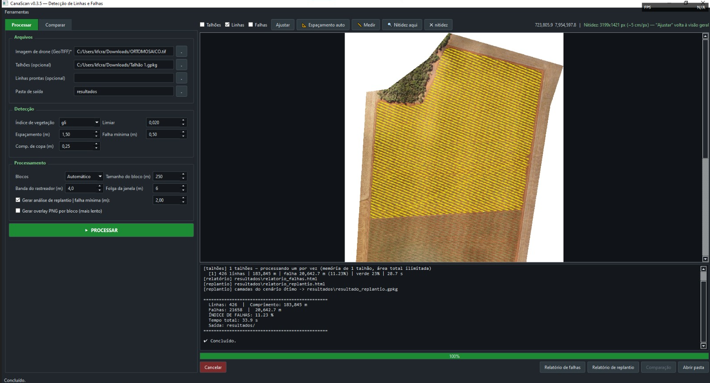
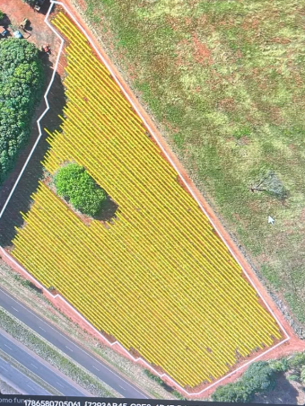

<!-- LANGUAGE NAVIGATION -->
<div align="right">
  <a href="https://github.com/KevinBertolini12/canascan/blob/main/README.md"></a>
  <a href="https://github.com/KevinBertolini12/canascan/blob/main/README_EN.md"></a>
</div>

# 🛸 CanaScan — Geospatial Sugarcane Planting Gap Analysis

> Computer vision and artificial intelligence system for processing drone orthomosaics, automated sugarcane planting gap detection, and decision-support reporting for precision agriculture.

---

## 📌 About the Project

**CanaScan** is a precision agriculture tool developed to analyze drone orthomosaics in sugarcane crops. Utilizing image processing techniques and deep learning models (U-Net), the system identifies crop rows, detects planting gaps, and generates detailed reports to optimize field management.

### 🚀 Key Features

- **Planting Gap Detection:** Automatic segmentation of crop rows and measurement of planting gaps.
- **Batch Processing:** Capability to continuously process multiple plots and industrial orthomosaics.
- **Executive Reports:** Export diagnostics and spatial metrics in CSV and HTML formats for data-driven decision-making.
- **Integrated GUI:** User-friendly desktop application interface designed for field and technical teams.

---

## 🛠️ Tech Stack

- **Language:** Python
- **Computer Vision & AI:** OpenCV, U-Net (Machine Learning / Deep Learning)
- **Desktop Interface:** PySide6
- **Data Analytics:** Pandas, NumPy

---

## 🖥️ Screenshots




---

## 💻 How to Run the Project

```bash
# Clone the repository
git clone [https://github.com/KevinBertolini12/canascan.git](https://github.com/KevinBertolini12/canascan.git)

# Navigate to the project directory
cd canascan

# Install dependencies
pip install -r requirements.txt

# Run the application
python iniciar.py
```

👤 Author:
Developed by Kevin Bertolini

